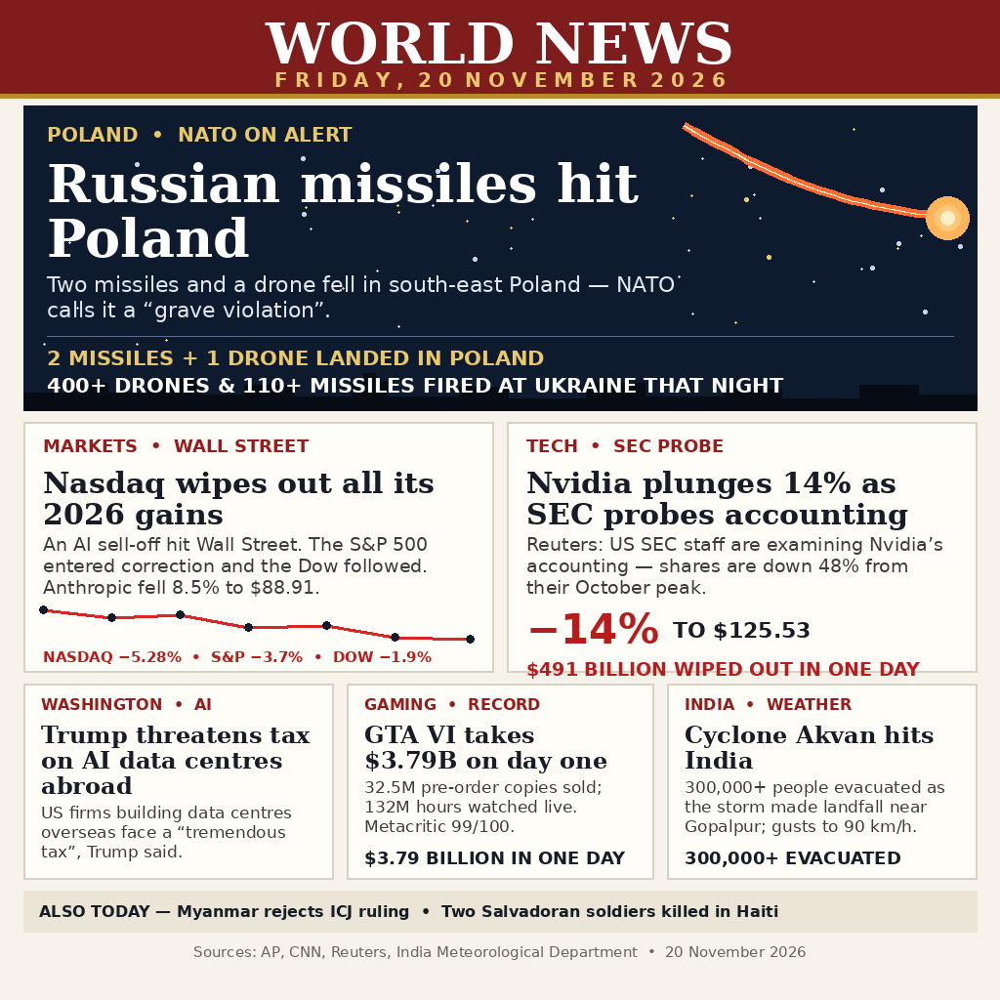

[](https://make.fun/bounty/news-image-20261120)
[](https://make.fun/bounty/news-image-20261120)
[](https://make.fun/bounty/news-image-20261120)

# World News — Friday 20 November 2026

A one-image summary of the world news of 20 November 2026, built for the
[make.fun bounty](https://make.fun/bounty/news-image-20261120)
"Sum up 20 November's world news in one image" ($250, top 50 paid).



## The front page

A premium newspaper front page (1024×1024 PNG) with a clear visual
hierarchy, so the news explains itself with no feed attached:

- **Hero — Russian missiles hit Poland.** Two missiles and a drone fell
  in south-east Poland during a huge Russian attack on Ukraine — NATO
  calls it a "grave violation". **400+ drones and 110+ missiles** were
  fired at Ukraine that night. Illustrated with a night sky and a
  glowing missile trail.
- **Nasdaq wipes out all its 2026 gains.** An AI sell-off hit Wall
  Street: Nasdaq **−5.28%**, the S&P 500 entered correction, the Dow
  followed. Anthropic fell **8.5% to $88.91** — with a red descending
  chart drawn in.
- **Nvidia plunges 14% as the SEC probes its accounting.** Reuters:
  US SEC staff are examining Nvidia's accounting — **$491 billion**
  of market value vanished in one day, down 48% from its October peak.
- **Trump threatens a tax on AI data centres abroad.** US firms building
  data centres overseas face a "tremendous tax", Trump said.
- **GTA VI takes $3.79B on day one.** 32.5M pre-order copies sold;
  132M hours watched live. Metacritic 99/100.
- **Cyclone Akvan hits India.** 300,000+ people evacuated as the storm
  made landfall near Gopalpur; gusts to 90 km/h.
- **Also today:** Myanmar calls the ICJ genocide ruling "unfair";
  two Salvadoran soldiers killed in Haiti.

Sources: AP, CNN, Reuters, India Meteorological Department. Every story
was date-checked as 20 November 2026 news.

## How it works

`main.py` (Python 3.13, standard library only, no network) validates the
bundled `front-page.png` — PNG signature, exactly 1024×1024, at most
1 MiB — and writes it byte-for-byte to `/output/entry.png`, then reads
the output back and verifies its SHA-256 matches the source. Running it
twice produces identical bytes.

```bash
python3 main.py           # writes /output/entry.png
python3 main.py --check   # validate only, write nothing
```

The image itself was drawn with Pillow (build-time only); the entry
program needs no third-party packages.

## License

MIT — see [LICENSE](LICENSE).
